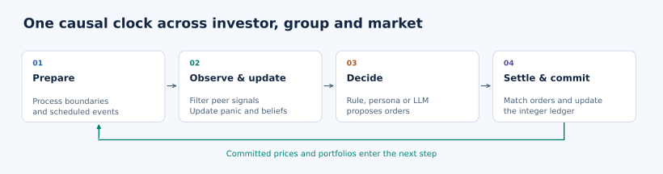
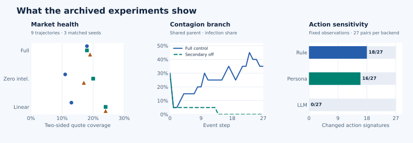

# EcoSim

**An agent-based simulator that connects investor decisions, group behavior and market institutions on one causal clock.**

EcoSim accompanies *Civitas Economica: An Interdisciplinary LLM Agent-Based Market Simulation Architecture for Multi-Scale Socio-Economic Dynamics*. The model links peer attention and panic contagion to confidence, valuation and order flow. Numerical rules, persona heuristics and LLM agents use the same order interface. The exchange applies a continuous double auction and settles trades through an integer cash and inventory ledger.

[English PDF](paper/Civitas_KDD27_EN.pdf) · [中文论文](paper/Civitas_KDD27_ZH.pdf) · [Download Overleaf ZIP](paper/Overleaf.zip?raw=true) · [Data and provenance](paper/source/source_data/README.md) · [Reproduction guide](reproduction/README.md)

## Architecture



The overview groups the paper’s eight phases into four stages. Portfolio exposures influence social ties, group states shape individual orders, and market execution updates the positions and prices that drive the next step. The dual-speed scheduler uses the same decision interface for numerical and model-backed actions. [Detailed architecture (PDF)](paper/source/figures/fig1_methodology_overview.pdf)

## Main results



| Experiment | What the archive shows |
| --- | --- |
| **Market health** | In nine 100-step trajectories across three matched seeds, **61–78%** of steps had no trade and **11–24%** had two-sided quotes. Each marker in the first panel is one trajectory. Shape and color identify the same seed across baselines. |
| **Mechanism and policy** | Across 11 branches of one parent world, disabling secondary contagion reduced peak infection from **45% to 5%** and maximum drawdown from **0.4754% to 0.1453%** in the matched comparison. The contagion–herding interaction on drawdown was zero. The halt branch had **2 tradable steps out of 27**. |
| **Fixed-observation cognition** | All **54** live model responses chose HOLD. The economic action signature changed in **0/27** LLM pairs, **16/27** persona pairs and **18/27** rule pairs. The constructed state and its retained behavior trace disagreed on risk and price references across the 54 live cases. |
| **Capacity and timing** | The Mac completed both the 100-step and 200-step runs. The ASUS runtime committed 12 steps and the outer controller stopped at its time limit. Three strict-validator timing pairs provide same-world comparisons. |

The health runs cover one model trading day each. The branches share one parent world and the cognition probe uses fixed observations. The formal three-question experiment matrix remains planned. [Figure source data and definitions](paper/source/source_data/README.md) · [Vector results figure](docs/figures/results.pdf)

## Reproduce the results

Clone the repository and use Python 3.11 or later. The first command uses the standard library to check the nine market-health projections, twelve terminal ledgers and 81 fixed-observation pairs.

```sh
git clone https://github.com/DengJunxian/EcoSim.git
cd EcoSim
python3 reproduction/verify.py --output ../ecosim-verified
```

Build all manuscript data figures, generated tables and homepage figures into a separate directory.

```sh
python3 -m venv .venv
. .venv/bin/activate
python -m pip install -r paper/source/scripts/requirements-figures.txt
python reproduction/rebuild.py --output ../ecosim-rebuilt
```

The rebuild uses the published data and produces figures, tables and a verification summary offline. The [reproduction guide](reproduction/README.md) lists the simulator source, the full historical archive replay entry point, and the inputs required for each route.

## Build the manuscript

Upload the [Overleaf ZIP](paper/Overleaf.zip?raw=true) as a new project, or use the files under [`paper/source/`](paper/source). Select **pdfLaTeX** for `main.tex` (English) and **XeLaTeX** for `main_zh.tex` (中文). The source includes the vector figures and generated tables.
